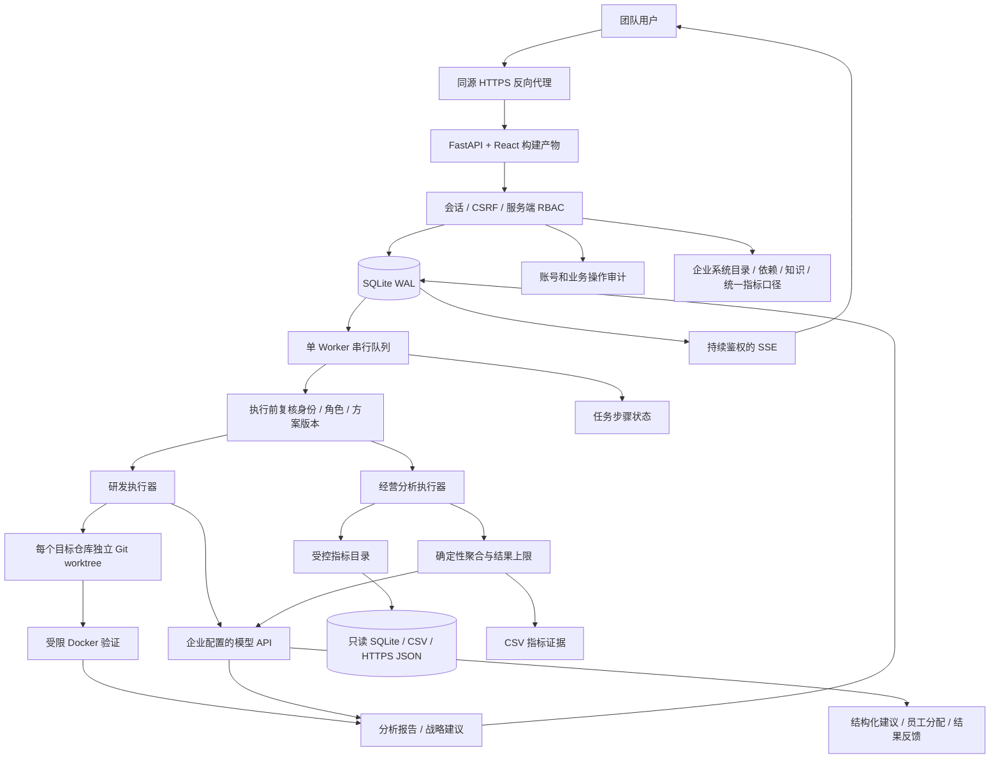

# 企业超级智能平台架构 v0.5

账号分系统管理员、普通成员。研发项目成员分负责人、开发者和只读；经营数据成员分数据负责人、分析师和只读。两套业务角色互不继承，权限由服务端检查，任务响应提供 UI 能力字段用于交互呈现。

经营分析使用 data_sources、data_source_members、metrics、analysis_jobs、analysis_events。文件数据源必须位于 `ESI_DATA_ROOTS` 白名单目录，不接受符号链接或隐藏路径；HTTPS JSON 数据源必须位于 `ESI_CONNECTOR_HOSTS` 主机白名单，发起只读 GET，可按批准配置追踪同源下一页，并受响应大小、行数、列数限制。指标预先限定表、聚合、值列、日期列和维度；模型产生的计划必须再次通过后端指标白名单校验。

enterprise_systems、system_resources、system_dependencies 维护系统图谱，knowledge_entries 保存人工确认的知识，metric_terms 与 metric_term_links 提供跨源指标术语。任务只能读取其成员对全部关联资源都有权限的系统上下文。task_projects 和 analysis_job_sources 记录任务的多个目标；创建人和完整任务查看者在每个目标具备相应权限；审批和验收按资源授权，允许不同负责人分别操作。跨源分析逐指标计算，结果标明数据源，不直接连接明细或执行跨库 JOIN。

workflow_steps 保存固定工作流的各阶段状态；现阶段由单 Worker 串行执行，步骤状态随任务状态同步。recommendations 保存模型提出的结构化建议，负责人可以将动作分配给无需底层数据权限的员工。actions 模块维护期限、站内通知和反馈历史；负责人可执行批准的指标复测，比较基线/目标并保存证据，未实现自动因果归因。

所有写操作携带会话 CSRF；Cookie 为 HttpOnly、SameSite=Strict；HTTPS 部署必须 Secure。角色和账号状态不从客户端信任。项目写操作在 SQLite 写事务中重新校验权限，审批以方案版本做并发控制。SSE 在会话失效或成员移除后终止。Worker 对每轮模型调用、工具执行和验证过程重查业务授权；退出登录不等于取消已授权的后台任务，但停用/撤销权限会停止任务。

经营分析的模型调用分两段。规划阶段只提供问题和指标目录；审批后由系统生成只读聚合查询；报告阶段只提供批准方案和聚合结果。原始业务明细、服务器路径和任意 SQL 不进入模型上下文。报告和证据都保留在任务结果中，供负责人验收。

Docker 验证使用无网络、只读根、无 capabilities 和资源限制；挂载仅当前工作区，额外只读挂载 .git 文件，避免容器改写宿主机 Git 元数据入口。不存在 Docker 或镜像时失败，不会切换宿主机。只有显式 local 开发模式可以运行本地命令。

后续：ERP/CRM/数据仓库专用连接器、增量同步、实体 ID 对齐和单位换算、数据脱敏策略、定时报表、可视化看板和 Office 导出；以及 OIDC/SSO、MFA、部门同步、PostgreSQL、队列与租约、多执行节点、任意步骤编排、强制双人复核、中央审计、预算配额、PR/CI 集成。当前不声称支持跨企业多租户隔离或恶意内核攻击下的完整安全边界。

## v0.5 执行与证据模块

- `orchestration.py`：逐资源/版本审批，批准版本档案，事务内领取，有限人工重试。领取立即转运行状态；取消不可重新进入队列。重试废弃旧批准，原工作区保留。
- `development.py`：结构化计划、传递影响清单、批准路径检查、验证配置快照、拓扑依赖和每仓执行证据。`worker.py` 执行期间反复校验角色及配置，依赖验证指纹失效后下游不可写入。
- `analysis.py`：决策说明、指标/术语/连接配置快照。`analytics.py`：有界确定性聚合、显式公共维度对齐、比较和假设情景、输入指纹与质量记录。明细不进入模型。
- `acceptance.py`：资源负责人只审阅自己资源的结果，验证版本、结果指纹与验收人现有权限，全部齐备后才完成任务。新版研发交付必须保留 Worker 验证时的代码指纹，当前代码发生变化则拒绝验收并要求重新验证。
- `actions.py`：员工权限独立于数据源，员工响应和历史裁剪目录元数据；配置/复测双重校验指标、术语与连接状态，外部读取不持有数据库写锁。
- `sources.py`：同源分页配置与健康记录。HTTP 全量读取受大小/页数/行数和时间预算限制，不返回不完整结果。

新增表采用应用内幂等加法迁移，旧任务 `plan_schema/governance_version=0` 保留兼容，新任务置 1 并强制新版约束。索引静态核对使用 create-table-sql 技能的 DBServe 规则快照；新增各表索引不超过三个，无外键。应用内升级包含 ALTER，未作为 DBServe 建表脚本提交。
